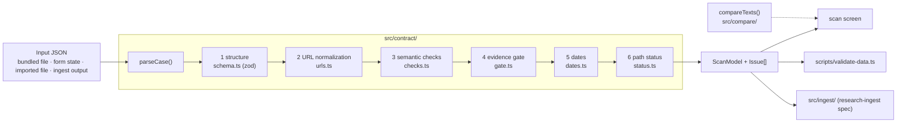

# Design Document: data-contract

## Overview

The data contract is one TypeScript module, `src/contract/`, plus a text comparison
module, `src/compare/`. The scan screen, "Scan your own bill", JSON import,
`npm run validate:data` and the research ingest all go through it. Both modules are pure
TypeScript with no DOM or Node imports, so the browser, the scripts and the tests run the
same code (`tech.md`).

Four design rules carry the requirements:

1. **Statuses are derived, never stored.** A path's status is computed from its kind, its
   evidence and the evidence gate. The `reviewState` written in data is a claim that the
   contract compares against the derived status (Requirement 3.8).
2. **The gate looks only at check records.** Text similarity, shared numbers and text
   differences never reach the status code (Requirements 2.3, 2.4, 7.5). `status.ts` does
   not import `src/compare/`, and a test enforces that.
3. **Every check names one role.** An evidence row passes only when one role, A or B,
   opened the official URL and found the excerpt word for word (D-001, D-008). A second
   check is not required on the screen. Loading demo cases keeps its own two-role
   condition (D-002, D-006).
4. **Problems are data.** Parsing never throws on bad input. It returns issues with a JSON
   path, a code, a severity and parameters; the UI turns codes into words from
   `src/i18n/` (Requirement 1.5).

## Architecture



### Files

| File | Responsibility |
|---|---|
| `src/contract/types.ts` | Exported types (below). No logic. |
| `src/contract/schema.ts` | zod schemas for `Case` and `Recheck`; structural errors become `schema_*` issues with JSON paths. |
| `src/contract/urls.ts` | Look-alike normalization, missing/malformed detection, session-token flag. |
| `src/contract/checks.ts` | Reference resolution, duplicate ids, title/publisher, excerpt length, pasted-text checks, kind/endpoint rules. |
| `src/contract/gate.ts` | `gateEvidence()`: pass/fail plus reasons for one evidence row. |
| `src/contract/dates.ts` | Partial-date parsing, timing against the reference date, same-kind conflicts. |
| `src/contract/status.ts` | `deriveStatus()`: one status, `drawable` flag and the list of what is still needed. |
| `src/contract/parse.ts` | `parseCase()` and `parseRecheck()`: run the stages and build the `ScanModel`. |
| `src/contract/index.ts` | Public exports. Nothing outside the module imports from the other files. |
| `src/compare/diff.ts` | `compareTexts()` on top of jsdiff. |

## Data model

Field names follow work order §4. Fields the work order does not list are marked *(added)*
with the requirement that needs them.

```ts
export type PartialDate = string;        // "YYYY-MM-DD" | "YYYY-MM" | "YYYY" | "unknown"
export type Role = "A" | "B";            // never a personal name (D-002)
export type LanguageTag = string;        // BCP 47: "en", "ko"

export interface Case {
  contractVersion: 1;                    // (added) lets old files fail loudly after a change
  caseId: string;                        // (added) stable file key, e.g. "us-116-hr748"
  title: string;                         // (added) display title, English
  jurisdiction: string;                  // "US", "KR", "EU"
  session: string | null;                // "116th Congress", "제22대 국회"
  promise?: PromiseRecord | null;        // optional (Req 1.3)
  documents: DocumentVersion[];          // in reading order; the renderer never re-sorts by date
  evidence: Evidence[];
  events: LegislativeEvent[];
  paths: Path[];
  provenance?: string[];                 // research row ids etc.; never evidence (Req 1.6)
}

export interface PromiseRecord {
  statement: string;
  sourceTitle: string;
  publisher: string;
  sourceUrl: string | null;
  date: PartialDate;
  ownOutlet?: boolean;                   // true for a Seoul Economic Daily article (D-016)
  excerpt?: string | null;               // Seoul Economic Daily article only, at most 200 characters; other outlets: none
  factSentence?: string | null;          // our own sentence for the fact the news item reports; other outlets use it instead of an excerpt
}

export interface DocumentVersion {
  documentId: string;                    // the number as the source writes it: "H.R. 748", "의안번호 2205453", "P.L. 116-136"
  versionId: string;                     // "ih", "enr", "original", "alternative", "promulgated"
  localEventLabel: string | null;        // the source's own stage label: "Introduced in House", "대안반영폐기"
  sourceUrl: string | null;
  title: string;                         // (added) Req 1.2
  publisher: string;                     // (added) Req 1.2
  sourceKind: "official" | "news" | "other"; // (added) Req 4.1, 4.3, 4.5
  ownOutlet?: boolean;                   // (added) news only: true for a Seoul Economic Daily article (D-016)
  factSentence?: string | null;          // (added) news only: our own sentence; shown where other sources show an excerpt (D-016)
  language: LanguageTag;                 // (added) language of the original text
  pastedText?: string | null;            // (added) text the user pasted; Req 6.3, 6.4, Req 7
  provenance?: string[];
}

export interface Evidence {
  evidenceId: string;
  documentId: string;
  versionId: string;
  anchor: string;                        // clause location as the source writes it: "Sec. 2(a)", "제18조제1항"
  excerpt: string;                       // original language; official ≤ 300, Seoul Economic Daily news ≤ 200 characters; "" on a version of news from another outlet (Req 4.7)
  translation?: { text: string; language: LanguageTag } | null;  // display only (Req 4.3)
  check: EvidenceCheck;                  // 확인 상태
  provenance?: string[];
}

export interface EvidenceCheck {         // Req 4.2, 4.6
  state: "matched_official" | "partial" | "could_not_open" | "not_checked" | "mismatch";
  url: string | null;                    // the URL the checker opened
  checkedBy: Role | null;                // the one role the gate needs (D-008)
  checkedAt: PartialDate | null;         // YYYY-MM-DD when set
  confirmedBy: Role | null;              // optional: the second role of a D-002/D-006 recheck; the gate does not require it
  confirmedAt: PartialDate | null;       // optional
  confirmedUrl: string | null;           // optional: the URL the second role opened; when set it must equal sourceUrl
}

export interface LegislativeEvent {
  eventId: string;                       // (added) so paths and the panel can point at it
  documentId: string;
  versionId: string;
  eventKind: EventKind;
  eventDate: PartialDate;
  evidenceRefs: string[];
}

export type EventKind =
  | "introduced" | "committee_note" | "amended" | "passed" | "discarded"
  | "promulgated" | "published" | "effective" | "applied" | "postponed"
  | "repealed" | "struck_down" | "other" | "unknown";

export interface Path {
  pathId: string;                        // (added)
  from: Endpoint;
  to: Endpoint;
  kind: PathKind;
  evidenceRefs: string[];
  reviewState: "confirmed" | "unverified";   // the author's claim (Req 3.8)
  absenceCheck?: AbsenceCheck | null;    // (added) Req 3.5, kind "not_included" only
  note?: string | null;                  // record-state wording only, e.g. "Left for further committee discussion"
}

export type Endpoint =
  | { type: "version"; documentId: string; versionId: string }
  | { type: "clause"; evidenceId: string }
  | { type: "promise" };

export type PathKind =
  | "next_version"                // number track: same documentId, a later version
  | "successor_document"          // number track: a different document continues it
  | "carried"                     // clause track: carried over or modified (Req 3.1)
  | "transferred"                 // clause track: officially moved into another law
  | "same_outcome_separate_law"   // clause track
  | "not_included";               // clause track: not found in that version

export interface AbsenceCheck {
  documentId: string;                    // the version that was searched
  versionId: string;
  scope: "whole_text" | { articles: string[] };
  searchedFor: string[];                 // terms or anchors looked for
  checkedBy: Role | null; checkedAt: PartialDate | null;       // one role is enough (D-008)
  confirmedBy: Role | null; confirmedAt: PartialDate | null;   // optional second role (D-002/D-006); not required
}
```

`matched_pasted_text` from Requirement 4.2 is not stored. The contract computes it when a
row has `state: "not_checked"` and its excerpt occurs word for word in the version's
`pastedText`. It never passes the gate.

### Results

```ts
export interface Issue {
  path: (string | number)[];             // JSON path into the input, e.g. ["documents", 2, "sourceUrl"]
  code: IssueCode;
  severity: "block" | "warn";
  params?: Record<string, string>;       // values for the i18n message
  message: string;                       // English fallback for scripts; the UI uses code + params
}

export interface ScanModel {
  case: Case;                            // records with block issues removed
  origin: "bundled" | "user";
  referenceDate: string;                 // YYYY-MM-DD
  gate: Record<string, GateResult>;      // by evidenceId
  paths: Record<string, PathView>;       // by pathId
  dates: Record<string, DateView>;       // by eventId
  excluded: { path: Issue["path"]; reason: IssueCode }[];
}

export interface GateResult { pass: boolean; reasons: GateReason[]; effectiveState: string }
export interface PathView {
  track: "number" | "clause";            // derived from kind (Req 2.1)
  status: PathStatus;
  drawable: boolean;                     // false for evidence_missing or unresolved endpoints (Req 3.3)
  needs: Need[];                         // what is still needed (Req 3.7)
}
export type PathStatus = "confirmed" | "not_verified" | "evidence_missing" | "omission_not_verified";
export interface DateView { timing: "past" | "scheduled" | "too_coarse" | "unknown"; conflictWith: string[] }
```

A confirmed path's label comes from its kind ("Same outcome, separate law", "Not found in
this final version", …), so the status list stays at four values while every kind still has
its own confirmed wording (Req 3.2).

### Recheck records (`data/verification/`)

The team's own checks (research-ingest Requirement 9, D-001, D-002, D-006) live in
`data/verification/<caseId>.json`. The contract owns the schema so that `validate:data`
and the ingest read it the same way.

```ts
export interface Recheck {
  recheckId: string;
  caseId: string;
  target: { researchId: string | null; evidenceId: string | null };  // e.g. "B4R-EVI-0005"
  sourceUrl: string;                     // official URL opened
  anchor: string;                        // as written on the page
  excerpt: string;                       // copied exactly, ≤ 300 characters
  result: "matched" | "partial" | "mismatch" | "could_not_open" | "not_found";
  checkedBy: Role; checkedAt: string;
  confirm: { by: Role; at: string; url: string; result: Recheck["result"] } | null;  // second role; D-002/D-006 loading needs it, the screen gate does not (D-008)
  note?: string | null;                  // record-state wording; no personal names
}
```

## Rules

### Tracks and endpoints

| Kind | Track | `from` | `to` | Extra rule |
|---|---|---|---|---|
| `next_version` | number | version | version | same `documentId`, different `versionId` |
| `successor_document` | number | version | version | different `documentId` |
| `carried` | clause | clause or promise | clause | — |
| `transferred` | clause | clause | clause | the two clauses sit in different documents |
| `same_outcome_separate_law` | clause | clause or promise | clause | the `to` clause sits in a different document |
| `not_included` | clause | clause or promise | version | `absenceCheck` names the `to` version |

A path that breaks its row gets a `kind_endpoint_mismatch` block issue. The track is derived,
so a path cannot be on both tracks (Req 2.1).

### Evidence gate (`gateEvidence`)

An evidence row passes only when every line holds; each failing line adds its reason.

| Check | Reason when it fails |
|---|---|
| Its version exists and `sourceKind` is `official` | `not_official_source` |
| `sourceUrl` is present and a valid http(s) URL after normalization | `source_url_missing` / `source_url_invalid` |
| `anchor` is not empty | `anchor_missing` |
| `excerpt` is not empty and within its limit (official 300, Seoul Economic Daily news 200) | `excerpt_missing` / `excerpt_too_long` |
| `check.state` is `matched_official` | `not_checked`, `partial`, `could_not_open`, `mismatch`, `pasted_text_only` |
| `check.url` equals `sourceUrl` after normalization; when `check.confirmedUrl` is set it must equal `sourceUrl` too | `checked_other_url` |
| `checkedBy` and `checkedAt` are set (one role is enough; `confirmedBy` and `confirmedAt` are optional) | `checker_missing` |
| If `pastedText` exists, the excerpt occurs in it word for word | `excerpt_not_in_pasted_text` |

The translation is never read by the gate (Req 4.3). For a user case (see "Origin" below)
the stored check is ignored, so its rows end at `not_checked` or `pasted_text_only`.

### Path status (`deriveStatus`)

Rank: `confirmed` is above every other status; the other three are not ordered.

1. An endpoint or evidence reference does not resolve → `not_verified`, `drawable: false`,
   need `fix_reference`.
2. `evidenceRefs` is empty → `evidence_missing`, `drawable: false`, need `add_evidence`.
3. For a clause-track path, evidence whose excerpt equals its version's `title` or
   `documentId` is set aside with `number_or_title_as_evidence` (Req 2.3).
4. `not_included` → `confirmed` only if `absenceCheck` names the `to` version, records a
   scope and one role (`checkedBy`, `checkedAt`; a second role is not required, D-008), at
   least one evidence row from that version passes, and every evidence row passes.
   Otherwise `omission_not_verified` with the missing items.
5. `same_outcome_separate_law` → `confirmed` only if every evidence row passes and passing
   rows come from both the `from` document and the separate law. Otherwise `not_verified`
   with need `evidence_from_both_documents` (Req 3.6).
6. Every other kind → `confirmed` if every evidence row passes, else `not_verified` with one
   need per failing row (`open_official_source`, `record_check`, `resolve_mismatch`, …).
7. If `reviewState` is `confirmed` and the derived status is not, add a
   `review_state_overclaim` warning and keep the derived status (Req 3.8).

### Dates

- `eventDate` must match `^\d{4}(-\d{2}(-\d{2})?)?$` or be `unknown`; precision comes from
  the length (Req 5.2).
- `timing` is derived only for `effective` and `applied` events: `past` when the latest
  possible day is on or before the reference date, `scheduled` when the earliest possible
  day is after it, `too_coarse` when the reference date falls inside the period, `unknown`
  for `unknown` (Req 5.6). The contract never says "in effect"; the screen shows the date
  with its timing.
- No function computes a date from another date or from rule text such as "six months
  after promulgation" (Req 5.4). The reference date is an input; the app passes today's
  local date and tests pass a fixed one (Req 5.5).
- Two events with the same `documentId`, `versionId` and `eventKind` but different dates
  both stay, and each gets a `date_conflict` warning naming the other (Req 5.7).

### News excerpts (D-016, Req 4.5, 4.7)

- A news item is a version with `sourceKind: "news"` or the `promise` record. It is from the
  Seoul Economic Daily only when `ownOutlet` is `true`; any other value means another
  outlet, Korean or foreign.
- Another outlet's item carries no excerpt: a non-empty `promise.excerpt`, or a non-empty
  `excerpt` on an Evidence row of such a version, is `news_excerpt_not_allowed` (block).
  The item shows outlet, date, title, link and `factSentence`. Nothing writes
  `factSentence`; a person does, and a missing one stays `null`.
- A Seoul Economic Daily article may carry an excerpt of at most 200 characters.
- News never passes the evidence gate, with or without an excerpt (Req 4.3).

### URLs

- In `sourceUrl`, `check.url`, `check.confirmedUrl` and `promise.sourceUrl` only:
  U+2236 becomes ":" and U+00B7 becomes "."; each change is a `url_lookalike_fixed` warning
  with the old and new value.
- `null`, `""` and `"unknown"` mean missing (`url_missing`, warning; the gate fails).
- Anything that is not an absolute http(s) URL after normalization is `url_invalid` (block).
- `;jsessionid=` gives a `url_session_token` warning. The URL is kept as it is.

### Severities

| Severity | Codes | Effect |
|---|---|---|
| block | `schema_*`, `duplicate_id`, `ref_unresolved`, `title_missing`, `publisher_missing`, `url_invalid`, `excerpt_too_long`, `news_excerpt_not_allowed`, `excerpt_not_in_pasted_text`, `date_format`, `date_kind_missing`, `kind_endpoint_mismatch` | The record leaves the `ScanModel` and is listed in `excluded`; the form keeps the field marked. `validate:data` fails on any block in bundled data. |
| warn | `url_missing`, `url_lookalike_fixed`, `url_session_token`, `anchor_not_in_pasted_text`, `date_conflict`, `review_state_overclaim`, `number_or_title_as_evidence`, `check_record_ignored` | The record stays. A warning never raises a status (Req 6.6). |

### Origin

`parseCase(input, { referenceDate, origin, bundledChecks })`.

- `bundled`: files in `data/cases/`. Until the research ingest exists they are entered
  directly from fully rechecked rows (D-020); the ingest may later write them from gated
  research rows and rechecks. Check records are used as written.
- `user`: the form and imported JSON. The browser cannot open official pages, so a user's
  own check record is ignored (`check_record_ignored`). The one exception: an evidence row
  copied from a sample keeps that sample's check record while its `documentId`,
  `versionId`, `anchor`, `excerpt` and the version's `sourceUrl` are unchanged
  (`bundledChecks` lookup). Any edit drops it.

As a result, a case entered by a user can show computed differences and "Not verified"
links, but cannot confirm a link with evidence nobody on the team checked.

### Comparison (`src/compare/diff.ts`)

```ts
export interface Segment { op: "equal" | "insert" | "delete"; text: string }
export function compareTexts(before: string, after: string):
  { ok: true; segments: Segment[] } | { ok: false; reason: "too_long" | "too_costly" };
```

- Uses jsdiff `diffWordsWithSpace`, which treats words, punctuation, newlines and runs of
  spaces as tokens. Joining the `equal` and `delete` segments rebuilds `before` exactly;
  joining `equal` and `insert` rebuilds `after` (Req 7.4). `diffWords` is not used because it
  ignores whitespace while diffing, so the texts are not guaranteed to be rebuilt exactly.
- English and Korean both separate words with spaces, which covers P0 (Req 7.2). Chinese
  and Japanese, which do not, need an `Intl.Segmenter` later; that is out of P0.
- Inputs over 20,000 characters each return `too_long`. The diff runs with
  `maxEditLength` and `timeout` (500 ms); when jsdiff gives up and returns `undefined`, the
  result is `too_costly`. The screen then says the texts are too long to compare.
- P0 shows no similarity figure (Req 7.5).

## Error handling

- `parseCase` and `parseRecheck` never throw on any JSON value. An unexpected exception is a
  bug: the caller catches it, shows `internal_error` and keeps the last valid model.
- `scripts/validate-data.ts` exits 0 when nothing blocks, 1 when a block issue exists, 2 on a
  usage error. Output is one line per issue: file, JSON path, code, message.
- `scripts/check-repo.ts` exits 1 when a tracked file matches the internal-material
  patterns of `publish-guard`, a `.env*` file is tracked, or `git check-ignore --no-index`
  reports any `.kiro` path as ignored.

## Correctness properties

Property-based tests use fast-check with generated cases of bounded size (up to 8 versions,
12 evidence rows, 10 paths). Each property runs at least 200 times.

1. **One status per path.** For any case, every path in `ScanModel.paths` has exactly one
   status and exactly one track. *Validates: 2.1, 3.2*
2. **No confirmed path rests on failing evidence.** For any case, if a path is confirmed,
   every one of its evidence rows passes the gate. *Validates: 3.4, 4.1*
3. **Failing evidence never confirms.** For any case and path, adding an evidence row that
   fails the gate never yields `confirmed`. *Validates: 3.4, 8.4*
4. **A shared number is not a clause link.** For any clause-track path whose only evidence
   repeats a version's title or `documentId`, the status is not `confirmed`. *Validates: 2.3*
5. **Texts do not decide links.** For any case, changing `pastedText` while every excerpt
   stays inside it leaves every path status unchanged. *Validates: 2.4, 7.5*
6. **User cases cannot confirm by themselves.** For any case parsed with origin `user` and an
   empty `bundledChecks`, no path is confirmed. *Validates: 4.1, scan-screen 5.4*
7. **Normalization touches URLs only.** For any case, normalization changes nothing outside
   the four URL fields, and applying it twice equals applying it once. *Validates: 4.4, 8.2;
   research-ingest 4.1, 4.4*
8. **No new dates.** For any case, every date in the model already appears in the input.
   *Validates: 5.4*
9. **Future dates are never past.** For any effective or applied event whose earliest
   possible day is after the reference date, `timing` is `scheduled`. *Validates: 5.6*
10. **Comparison rebuilds both texts.** For any two strings, joining the right segments
    rebuilds each, comparing a string with itself gives only `equal`, and two runs give the
    same result. *Validates: 7.1, 7.3, 7.4*
11. **Issues point at the input.** For any input, every issue path resolves to a location in
    that input. *Validates: 1.5*

## Testing strategy

- `npm test` runs `vitest run`, offline (Req 8.3).
- Regression fixtures in `tests/fixtures/contract/`, synthetic or short official excerpts,
  no news text (Req 8.5): same number but a different version; a different number that is a
  legitimate successor; a path without evidence; a missing publisher; a future effective
  date; an official transfer next to a separate-law outcome; a translation offered as
  evidence; look-alike URL characters; two similar texts with no relation evidence; a
  recorded "confirmed" whose evidence fails the gate (Req 8.1, 8.2). Each fixture's
  expected statuses and issue codes sit next to it.
- Unit tests for each file in the table above, and a test that `status.ts` and `gate.ts`
  import nothing from `src/compare/`.
- The properties above live in `tests/contract/properties.test.ts`.

## Hooks after this spec

| Hook | New action |
|---|---|
| `research-data-check` | `npm run --silent validate:data` |
| `evidence-gate-check` | `npm run --silent test:gate` (`vitest run tests/contract tests/compare`; `tests/ingest` joins when the ingest exists, D-020) |
| `publish-guard` | `npm run --silent check:repo` |

## Decisions in this design

Approved by the product owner on 2026-11-23; recorded in `docs/DECISIONS.md`.

1. (D-008) The gate needs one role, A or B, who opened the official URL and found the
   excerpt word for word; the same holds for the absence check of a `not_included` path. A
   second check is not required. The loading conditions in D-002 and D-006 are unchanged:
   for demo cases a recheck still needs two different roles, and `data/verification/` keeps
   its `confirm` part.
2. (D-009) Cases entered or imported by a user cannot confirm links with their own check
   records; only evidence copied unchanged from a sample keeps its check.
3. (D-010) Number-track kinds `next_version` and `successor_document`; clause-track kinds
   follow Requirement 3.1 (`carried` covers "modified"; the computed difference shows how).
4. (D-011) Versions appear in the order the case file lists them, not sorted by date.
5. (D-012) No similarity figure in P0.
