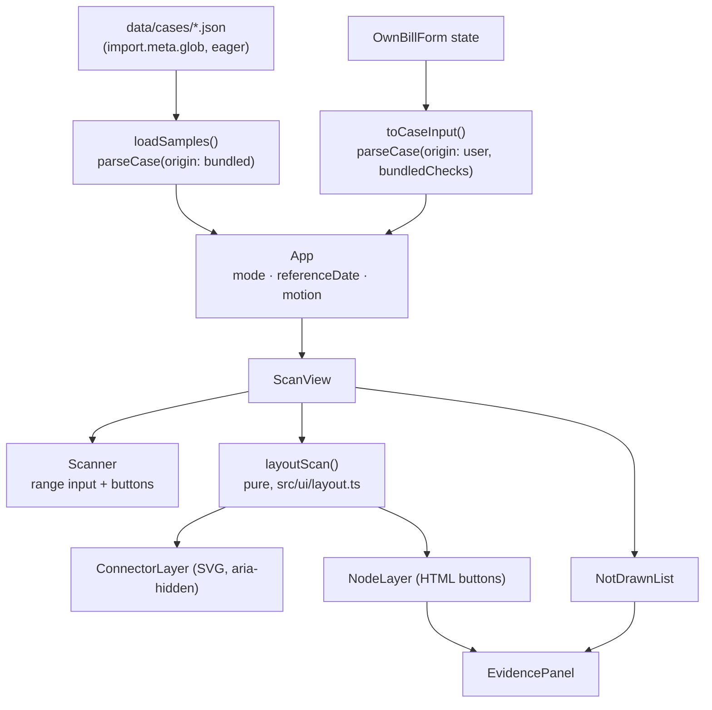

# Design Document: scan-screen

## Overview

A static single-page React app (Vite, TypeScript strict) with one page and three modes:
the US sample, the Korean sample and "Scan your own bill". Every mode renders a
`ScanModel` from the data contract (`.kiro/specs/data-contract/design.md`). The screen
never decides a status: it draws what `parseCase` returns and takes every word from
`src/i18n/en.json`.

The core idea of the screen is the **scanner**. Before scanning, the number line and the
clause lines lie on top of each other and look like one bill. As the scanner passes each
document version, the clause lines move off the number line into their own lanes. For
H.R. 748 the number line runs straight on to P.L. 116-136 while the repeal clause leaves it
and ends at P.L. 116-94: "Same number. Different body."

## Architecture

| File | Responsibility |
|---|---|
| `src/main.tsx` | Mounts `<App>`; sets `data-motion` from `prefers-reduced-motion`. |
| `src/ui/App.tsx` | Mode switcher, reference date (today's local date), motion toggle. |
| `src/ui/samples.ts` | Loads and parses `data/cases/*.json`. A sample with block issues shows its issue list instead of a scan. |
| `src/ui/ScanView.tsx` | Scanner, layers, not-drawn list, comparison strip. |
| `src/ui/layout.ts` | `layoutScan(model, { orientation, scanned })`: pure, no DOM. |
| `src/ui/ConnectorLayer.tsx` | SVG lines only; hidden from assistive technology. |
| `src/ui/NodeLayer.tsx` | Version nodes, clause nodes and path labels as focusable HTML buttons. |
| `src/ui/EvidencePanel.tsx` | Source details for a node or a path. |
| `src/ui/NotDrawnList.tsx` | Paths the contract marks `drawable: false`, with what each needs. |
| `src/ui/DiffText.tsx` | Renders `compareTexts()` segments. |
| `src/ui/form/OwnBillForm.tsx` | "Scan your own bill" fields, JSON import, issue messages. |
| `src/ui/form/toCaseInput.ts` | Form state to contract input; JSON path to field id map. |
| `src/i18n/en.json`, `src/i18n/t.ts` | Strings and `t(key, params)`. |
| `src/ui/styles.css` | Plain CSS with custom properties; line patterns; motion rules. |

## Layout model

`layoutScan` turns a model into positions, with no DOM measurement, so it can be tested
and gives the same result in every browser.

- **Columns:** one per document version, in case-file order. A separate law that is not on
  the number line (P.L. 116-94) still gets its own column.
- **Lanes:** lane 0 is the number track. Clause paths are grouped into chains (connected
  clause endpoints) and each chain gets the next lane, in order of first appearance.
- **Scanner value** `s` goes from 0 to the number of columns. For a column `c`,
  `reveal(c) = clamp(s − c, 0, 1)`. A clause node's lane offset is its lane's offset times
  `reveal(c)`: at `s = 0` every clause node sits on the number line; once the scanner has
  passed its column it sits in its own lane.
- **Orientation:** `horizontal` at 720 px and wider (columns left to right, lanes top to
  bottom); `vertical` below 720 px (versions top to bottom, lanes left to right). Both use
  the same nodes, connectors and labels; only coordinates change.
- **Output:** `nodes` (id, kind, column, lane, x, y), `connectors` (pathId, SVG path data,
  line pattern) and `labels` (pathId, x, y). A path with `drawable: false` gets no
  connector and no label; it goes to `NotDrawnList`.

The SVG layer and the HTML layer share one coordinate box, so labels and buttons sit on
the lines without measuring the DOM.

## Lines without colour

Each kind has its own line pattern and short text label, and each status has its own text
and end marker. Colour is extra.

| Kind | Line | Label |
|---|---|---|
| `next_version` | thick solid | "Same number, next version" |
| `successor_document` | thick solid with arrowhead | "Continued as {documentId}" |
| `carried` | thin solid | "Carried into a later version" |
| `transferred` | double line | "Transferred to another law" |
| `same_outcome_separate_law` | long dash | "Same outcome, separate law" |
| `not_included` | dotted, ends in an open circle | "Not found in this final version" |

| Status | Marker | Text after the label |
|---|---|---|
| `confirmed` | filled end dot | (none) |
| `not_verified` | hollow end dot with "?" | "Not verified" |
| `omission_not_verified` | hollow end dot with "?" | "Omission not verified" |
| `evidence_missing` | not drawn | listed as "Evidence missing" |

Screen-reader names spell out the whole line, for example "Clause path from H.R. 748 Sec. 2
to P.L. 116-94 Div. N Sec. 503: Same outcome, separate law. Not verified."

## Components

### Scanner

- A native `<input type="range">` from 0 to the number of columns, step 1, labelled "Scan
  the bill". Arrow keys move one column; Home and End go to the ends.
  `aria-valuetext` says which versions have been scanned.
- Buttons "Scan next version", "Back", "Show all" and "Reset" do the same without dragging
  (Req 6.2).
- While dragging, the value moves continuously (the user is moving it). The buttons animate
  the step over 400 ms unless motion is reduced, in which case the change is immediate
  (Req 6.3).

### Version and clause nodes

- Version node: `documentId`, `localEventLabel` and the dates of that version, each with its
  kind ("Promulgated 2026-02-10", "Effective 2026-08-11"). A future effective or applied
  date reads "Scheduled" (Req 4.5). Unknown values read "Not verified" (Req 4.4).
- Clause node: anchor ("Sec. 2(a)", "§18①") and the first 60 characters of the excerpt,
  marked up with `lang` set to the version's language.
- Path label: kind label and status text, as in the tables above.
- Activating any of them (click, tap, Enter or Space) opens the evidence panel.

### Evidence panel

- For a version: title, publisher, version label, every date with its kind and timing, the
  original link (new tab, `rel="noopener noreferrer"`) and the source language.
- For a clause: the version details plus anchor, excerpt in the original language, the
  translation labelled "Translation" when present (never in place of the original), and who
  checked it, as roles and dates (Req 3.2).
- For a path: kind, status, the "Needs" list from the contract, and for each evidence row the
  clause location in the earlier and the later document. For `carried`, `transferred` and
  `same_outcome_separate_law` paths the panel also shows the computed difference between the
  two excerpts (Req 3.1, 3.3).
- Wide screens show it as a side panel; narrow screens show it below the scan. On open,
  focus moves to the panel heading; Close and Escape return focus to the item that opened it
  (Req 3.4).

### Not-drawn list

Below the scan: every path the contract marks not drawable, with its status and needs, for
example "Evidence missing: add the clause from the final version" (Req 4.2).

### Scan your own bill

Sections, top to bottom:

1. **Bill:** jurisdiction, session, bill number.
2. **Versions** (add, remove, reorder with buttons): version label, title, publisher, source
   URL, original language, dates (kind chosen from the contract's list, date optional), and
   optional pasted text.
3. **Clauses:** for each version, anchor and excerpt. The tool checks that the excerpt is in
   the pasted text when there is one.
4. **Compare:** pick two clauses or two versions; the difference appears at once in the same
   scan view (Req 5.3).
5. **Links** (optional): from, to, kind and the evidence rows that back it. There is no
   control to mark a link confirmed (Req 5.4).
6. **Promise** (optional): statement, source and date.

Behaviour:

- "Start from a sample" copies a sample's items into the form. Rows copied unchanged keep
  their checks; an edited row loses its check (data-contract design, "Origin").
- Every contract issue appears next to the field its JSON path points to, with the message
  from `en.json`. Block issues keep a record out of the scan until fixed; warnings do not.
- "Import JSON" reads a local file with `FileReader`, runs `parseCase`, and fills the same
  fields; every field can also be typed in by hand (Req 5.6).
- The form state lives in `sessionStorage` under `billxray.own` and nowhere else. Nothing
  is sent over the network (Req 5.7).
- A banner on user cases: "Entered by you. Bill X-Ray compared the texts. Links stay Not
  verified until the team checks them on the official pages."

### Difference text

`DiffText` renders inserted text in `<ins>` (underlined) and deleted text in `<del>`
(struck through), each with visually hidden "inserted" or "deleted" words for screen
readers, so the difference reads without colour. Whitespace-only changes render as plain
text. When `compareTexts` returns `too_long` or `too_costly`, the strip says the texts are
too long to compare.

## Strings

- `src/i18n/en.json` holds every user-facing string under dotted keys: `app.*`, `mode.*`,
  `scanner.*`, `kind.*`, `status.*`, `need.*`, `issue.*`, `dateKind.*`, `timing.*`,
  `panel.*`, `form.*`.
- `t(key, params)` replaces `{name}` placeholders. In tests a missing key throws.
- `ko.json` is P1 and uses the same keys.
- `scripts/check-copy.ts` (`npm run check:copy`):
  1. Fails on the evaluative words in `ui-copy.md`, in English and Korean, in `src/i18n/*.json`
     and `src/ui/**/*.tsx`.
  2. Uses the TypeScript compiler API (already a dev dependency) to fail on JSX text and on
     `aria-label`, `title`, `placeholder` and `alt` string literals in `src/ui/` that do not
     come from `t()`.
  It exits 0 or 1 with file and line. When it exists, `ui-wording-check` switches to it.

## Motion and focus

- `data-motion="reduce"` on `<html>` comes from `prefers-reduced-motion: reduce` or the
  in-app "Reduce motion" toggle (`aria-pressed`). CSS removes transitions under it, and the
  scanner buttons skip their animation.
- `:focus-visible` gets a 3 px outline. Tab order: mode switcher, scanner, scanner buttons,
  nodes in reading order (column, then lane), path labels, not-drawn list, panel.

## Local only

- `vite.config.ts`: `server` and `preview` use host `127.0.0.1`, port 4748, `strictPort`.
- No fonts, scripts or images from other hosts. The only outgoing traffic is a source link
  the user opens.

## Demo path (45 seconds)

| Time | Screen |
|---|---|
| 0–12 s | US mode opens with the heading and tagline. The presenter drags the scanner; the repeal clause leaves the number line. |
| 12–24 s | Korea mode. The number line runs from bill 2205453 through alternative 2215103 to Act No. 21337; §15 continues to §18, §33 ends in "Not found in this final version". The presenter opens one path's official source. |
| 24–45 s | Scan your own bill: two versions of an unseen case pasted, the difference appears, two anchors opened. Links show "Not verified". |

If the Korean sample is removed under D-006, the Korea mode button is hidden until the
product owner chooses a replacement.

## Error handling

- A sample with block issues shows "This sample failed its checks" and its issue list, not a
  partial scan.
- An exception thrown while rendering is caught by one error boundary around `ScanView`; it
  shows "Something went wrong reading this case" and keeps the mode switcher working.
- A JSON file that is not valid JSON shows `issue.import_not_json`; nothing in the form
  changes.

## Correctness properties

Property tests (fast-check) on `layoutScan` and component tests (Testing Library, jsdom):

1. **Drawn lines match drawable paths.** For any model, there is exactly one connector and
   one label per path with `drawable: true`, and none for the others. *Validates: 4.1, 4.2*
2. **Same content in both orientations.** For any model and scanner value, both orientations
   give the same node ids, connector ids and label texts. *Validates: 6.1*
3. **The scanner splits monotonically.** For any model, moving the scanner forward never
   moves a clause node back toward the number line; at 0 every clause node is on lane 0, and
   at the end every clause node is in its own lane. *Validates: 1.2*
4. **The screen shows the contract's status.** For any model, each path label's status text
   equals the status in `ScanModel.paths`. *Validates: 4.1, 4.6*
5. **No colour-only meaning.** For any kind and status, the rendered label has non-empty
   text and the connector has the kind's line pattern. *Validates: 4.3*
6. **User cases stay unconfirmed.** For any form state with no rows copied from a sample, no
   label reads as confirmed. *Validates: 5.4, 5.5*

## Testing strategy

- Component tests:
  - The US sample shows "Same number. Different body." and "Follow the clause, not just
    the bill number." (Req 1.1).
  - Arrow keys on the scanner reach the split state (Req 1.2, 6.2).
  - Enter on a node opens the panel with title, publisher, anchor and link; Escape returns
    focus (Req 3.1, 3.4).
  - A translation is labelled (Req 3.2).
  - The not-drawn list shows an evidence-missing path (Req 4.2).
  - A future effective date reads "Scheduled" with a fixed reference date (Req 4.5).
  - The form shows a block message next to a broken URL field (Req 5.4).
  - JSON import fills the fields (Req 5.6).
- A test fails if `fetch`, `XMLHttpRequest` or `WebSocket` is called while the app runs
  (Req 8.1).
- A test runs the `check:copy` functions on `src/` (Req 8.2, 8.4).
- Manual checks, recorded with screenshots in `docs/mockup/screens/`: 360 px and desktop
  widths, keyboard only, reduced motion, and a timed rehearsal of the demo path (Req 6, 7).
  The 15-second viewer test stays an internal goal until it is measured (Req 7.2).

## Decisions in this design

Approved by the product owner on 2026-11-23; recorded in `docs/DECISIONS.md`.

1. (D-013) The scanner metaphor: lines start on top of each other and separate as the
   scanner passes; the number line stays straight.
2. (D-014) Below 720 px the scan turns vertical with the same nodes and lines.
3. (D-009) User cases show a banner and keep links "Not verified" (from the data-contract
   design).
4. (D-015) The Korea mode button is hidden if D-006 removes the Korean sample, until the
   product owner picks a replacement.
